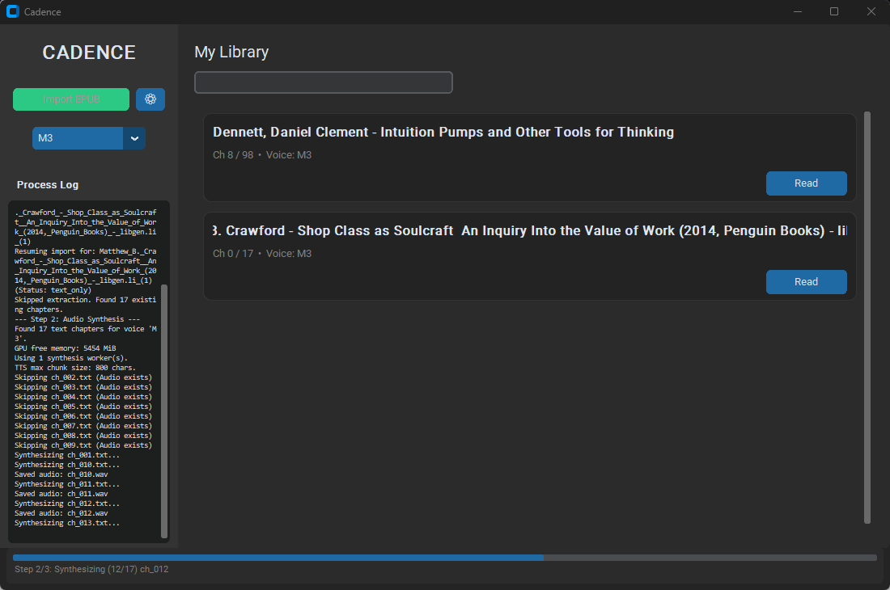
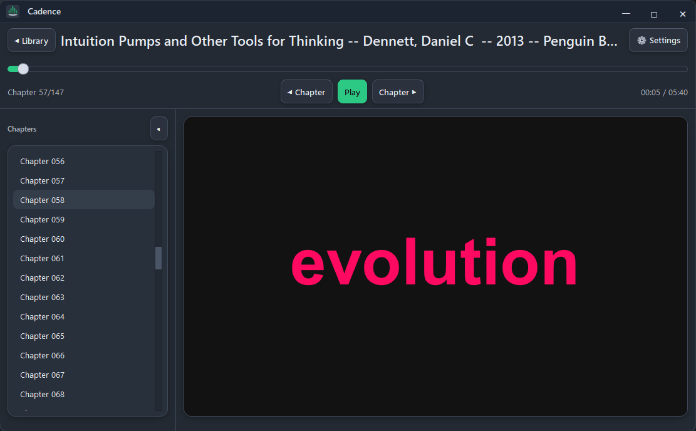
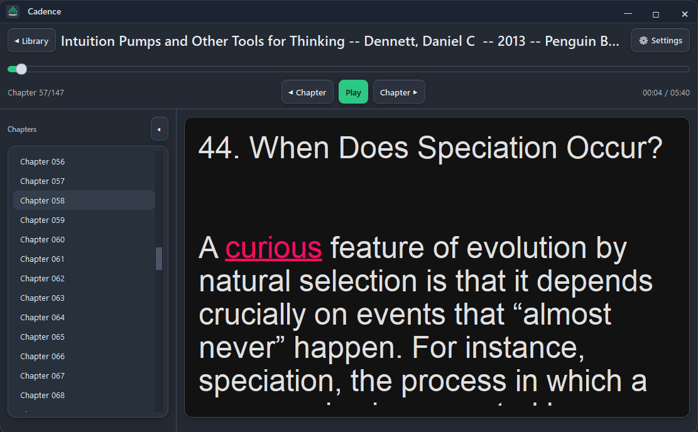

# Cadence
Cadence is an immersive reading pipeline: **book file -> chapter text -> audiobook audio -> word-level synced reader data**.

## Overview
- Imports EPUB/MOBI/AZW3 files (MOBI/AZW3 are converted to EPUB via Calibre) and extracts ordered chapter text.
- Synthesizes chapter audio with [Supertonic 3](https://pypi.org/project/supertonic/1.3.1/) across 31 languages.
- Aligns audio to text with WhisperX for word timestamps.
- Plays back in a synced reader/player UI.
- Uses a streaming chapter pipeline so reading can start before full import finishes.

## Pipeline
1. Source normalization: MOBI/AZW3 -> EPUB (Calibre, when needed)
2. EPUB extraction (Calibre) -> `library/<book>/content/ch_XXX.txt`
3. Per chapter: TTS synthesis (Supertonic) -> `library/<book>/audio/ch_XXX.wav`
4. Per chapter: Alignment (WhisperX) -> `library/<book>/content/ch_XXX.json`
5. Player can read chapters as soon as each chapter has audio + alignment.

## Import Behavior
- Cadence now runs **chapter-by-chapter interleaved processing**:
  - If a chapter already has `.wav`, Cadence skips synthesis and aligns it.
  - If `.wav` is missing, Cadence synthesizes first, then aligns.
  - If `.wav` and `.json` both exist, Cadence skips that chapter.
- This makes resume robust after interruptions and enables immediate reading while import is still running.
- Library cards update live with ready counts (`Audio x/y`, `Alignment x/y`) during import.
- EPUB `dc:language` is saved in `metadata.json` and passed to Supertonic. Regional tags such as `es-CL` use their base code; missing or unsupported codes use `na`.
- New books store `tts_backend` and `tts_model`. Resume uses the book's stored voice and model even if the current settings change.
- Older books without TTS identity keep their existing audio. For missing chapters, Cadence warns that the historical model is unknown, uses the configured Supertonic model once, and stores that continuation configuration for later resumes. This does not establish which model produced older WAV files. Select the known older model before continuing if needed.

## Read While Importing
Cadence processes books one chapter at a time, not as one long batch.

- As soon as a chapter finishes synthesis + alignment, it is immediately readable.
- You can open the reader and start from available chapters while the rest of the book continues importing.
- If import is interrupted, re-import resumes from existing chapter outputs instead of starting over.

## UI Preview




## Requirements
- Python 3.12 and [uv](https://docs.astral.sh/uv/getting-started/installation/).
- Apple Silicon macOS, Windows 10/11 x64, or Linux x64.
- [Calibre](https://calibre-ebook.com/download) for importing books.
- FFmpeg in `PATH` for playback speed control and WhisperX.
- An NVIDIA GPU is optional on Windows/Linux. The default install uses CPU wheels.

## Install
### macOS (Apple Silicon)
1. Install FFmpeg with Homebrew:
   ```bash
   brew install ffmpeg
   ```
2. Install the [Calibre app](https://calibre-ebook.com/download_osx) in `/Applications`.
3. Install [uv](https://docs.astral.sh/uv/getting-started/installation/) if needed.
4. Install Cadence from the repository root:
   ```bash
   uv sync --locked
   ```
5. Start Cadence:
   ```bash
   uv run main.py
   ```

### Windows
1. Install Python 3.12 and [uv](https://docs.astral.sh/uv/getting-started/installation/).
2. Install [Calibre](https://calibre-ebook.com/download_windows) at its default location, or set `CADENCE_CALIBRE_PATH`.
3. Install FFmpeg and add its directory to `PATH`.
4. Install Cadence from the repository root:
   ```powershell
   uv sync --locked
   ```
5. Start Cadence:
   ```powershell
   uv run main.py
   ```

### Linux
1. Install Python 3.12 and [uv](https://docs.astral.sh/uv/getting-started/installation/).
2. Install Calibre, FFmpeg, and the Qt system libraries for your distribution. On Ubuntu:
   ```bash
   sudo apt-get install calibre ffmpeg libegl1 libgl1 libpulse0 libxkbcommon-x11-0 libxcb-cursor0
   ```
3. Install Cadence from the repository root:
   ```bash
   uv sync --locked
   ```
4. Start Cadence:
   ```bash
   uv run main.py
   ```

### Runtime profiles
`uv sync --locked` creates `.venv` with CPU ONNX Runtime and matching Torch/Torchaudio 2.6.0.
It also installs the development tools. Existing `venv` directories are kept.

For NVIDIA GPUs on Windows/Linux, install and run the GPU profile:
```bash
uv sync --locked --no-group cpu --extra gpu
uv run --no-group cpu --extra gpu main.py
```
This selects ONNX Runtime GPU 1.24.1 and the official CUDA 12.4 Torch/Torchaudio wheels.
The machine also needs compatible NVIDIA drivers and ONNX Runtime's [CUDA/cuDNN runtime libraries](https://onnxruntime.ai/docs/execution-providers/CUDA-ExecutionProvider.html#requirements).
Use the same profile flags for each `uv run`; a plain `uv run` restores the default CPU profile.
The `cpu` group and `gpu` extra conflict, so uv rejects a request for both.
The GPU extra is for Windows/Linux; use the default profile on macOS.

The lockfile uses version-specific [uv metadata overrides](https://docs.astral.sh/uv/concepts/resolution/#dependency-metadata)
for Supertonic 1.3.1 and faster-whisper 1.1.0. Each package requests the CPU `onnxruntime`
distribution upstream, although both ONNX distributions expose the same API. The overrides
remove only that requirement. Cadence's selected profile supplies exactly one runtime.
Use uv for installation; plain pip does not apply these overrides.

Supertonic uses CPU by default on this Mac setup. On a 71-word Spanish chapter
(M3 voice, 8 steps, speed 1.05, seed 42; 26.54 seconds of audio), CPU synthesis took
7.33–8.38 seconds over three runs (median 7.58). CoreML took 36.00 seconds on its
first synthesis; its second had not finished after 140 seconds and was stopped.
Model loading took 0.74 seconds for CPU and 10.66 seconds for CoreML.
These measurements apply to this chapter and machine. To try CoreML when available,
set `CADENCE_USE_COREML=1` before starting Cadence; `CADENCE_FORCE_CPU=1` takes priority.

WhisperX uses CPU with `int8` when CUDA is unavailable. Faster-whisper has no MPS backend.
To keep a separate WhisperX environment, set its interpreter before starting Cadence:
```powershell
$env:CADENCE_WHISPERX_PYTHON="C:\path\to\venv_whisperx\Scripts\python.exe"
```
```bash
export CADENCE_WHISPERX_PYTHON="/path/to/venv_whisperx/bin/python"
```

## Run
```bash
uv run main.py
```

## Configuration
Cadence uses `cadence_settings.json` (managed from the UI settings cog next to **Import Book**).

- Settings are persisted automatically when you click **Apply**.
- Settings are applied immediately to the current app process.
- `CADENCE_*` environment variables are still usable for one-off CLI/script runs.

Useful keys:
- `CADENCE_EXTRACT_WORKERS`
- `CADENCE_SYNTH_WORKERS`
- `CADENCE_TTS_MAX_CHARS`
- `CADENCE_TTS_MODEL`: `supertonic-3` by default; `supertonic-2` and `supertonic` remain available.
- `CADENCE_TTS_SPEED`: `0.7`–`2.0`, default `1.05`.
- `CADENCE_TTS_STEPS`: integer `1`–`100`, default `8`.
- `CADENCE_FORCE_CPU`
- `CADENCE_CUDA_ONLY`
- `CADENCE_WHISPERX_MODEL`
- `CADENCE_WHISPERX_BATCH_SIZE`
- `CADENCE_WHISPERX_COMPUTE_TYPE`
- `CADENCE_WHISPERX_DEVICE`
- `CADENCE_WHISPERX_PYTHON`
- `CADENCE_CALIBRE_PATH`

The runtime settings dialog validates the TTS speed and steps before applying them. Supertonic's package handles text chunking through `max_chunk_length`; `CADENCE_TTS_MAX_CHARS` controls that value. A single sentence beyond the package's 100,000-character input limit is not supported.

WhisperX detects each chapter's language for alignment. Its diagnostic `ch_XXX.whisperx_report.json` records the detected language; the reader's alignment JSON format is unchanged.

## Project Docs
- [Contributing](CONTRIBUTING.md)
- [Changelog](CHANGELOG.md)
- [Architecture](docs/ARCHITECTURE.md)
- [Troubleshooting](docs/TROUBLESHOOTING.md)
