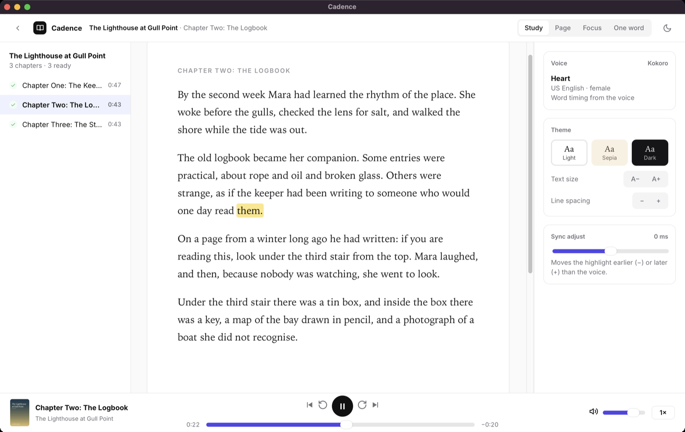
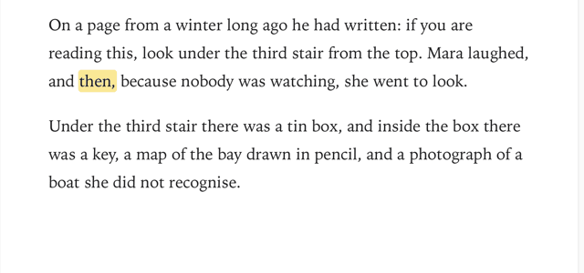
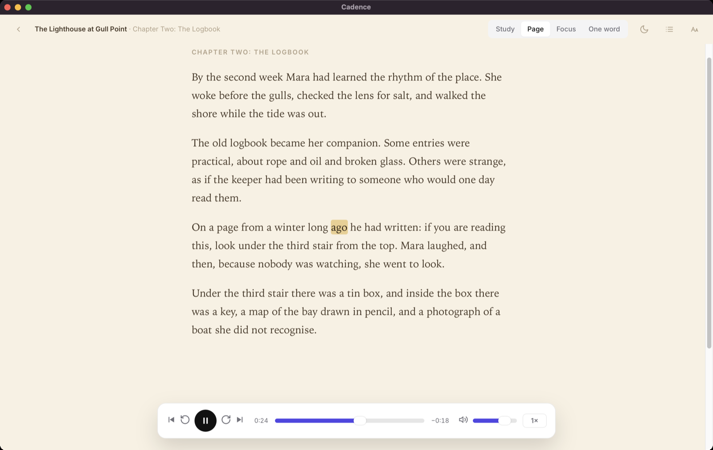
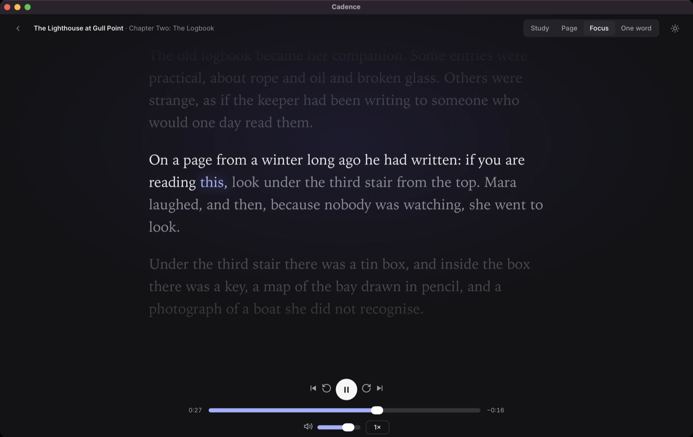
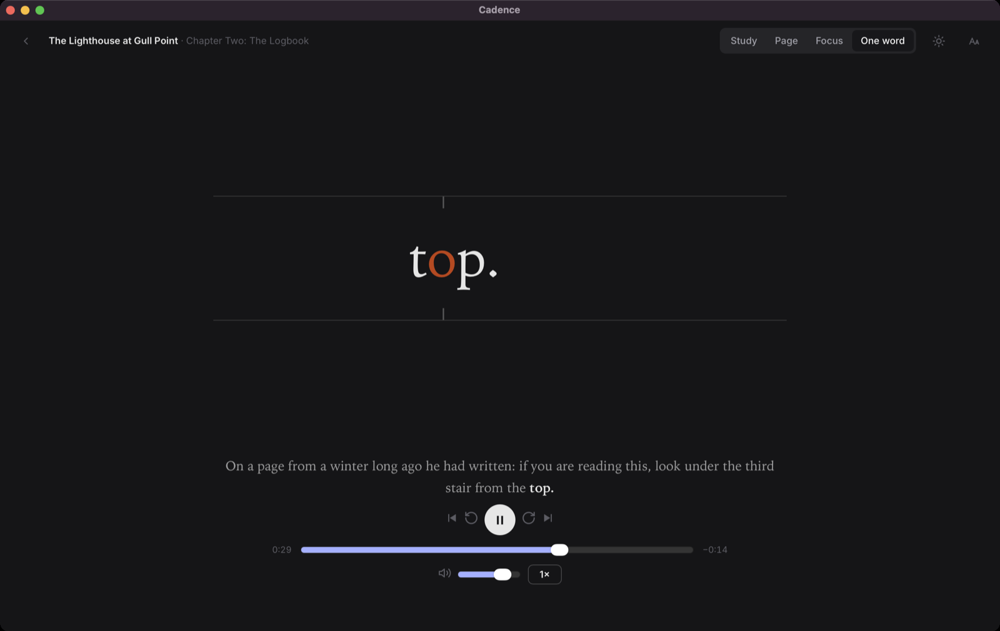
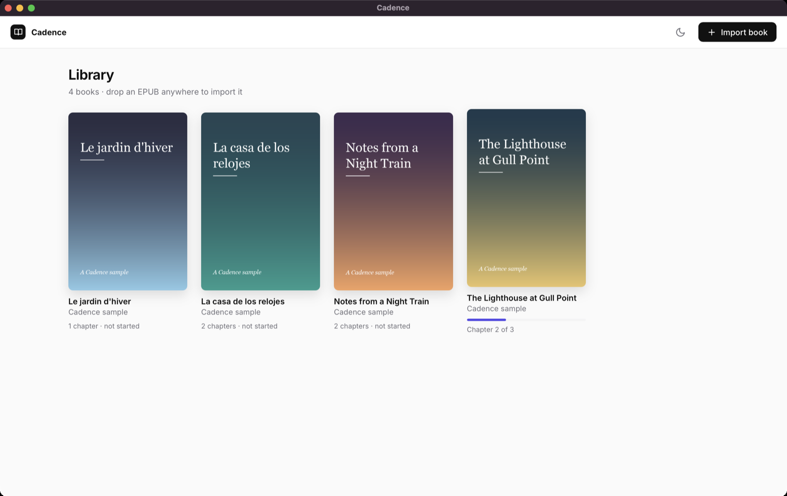
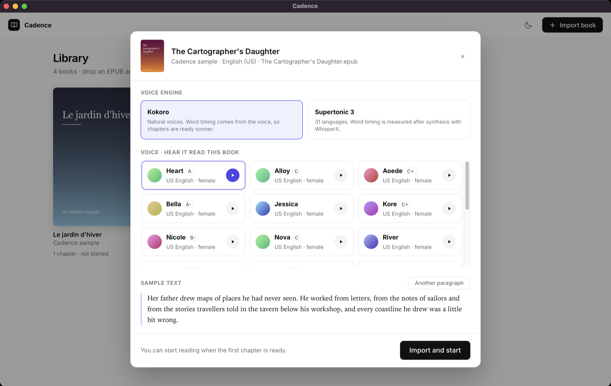
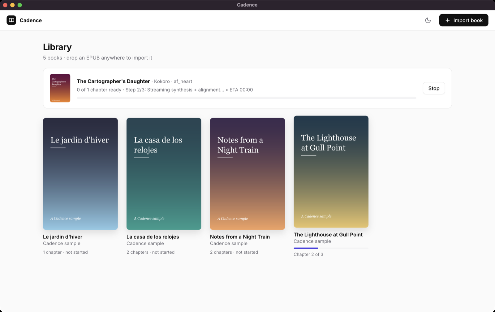

<picture>
  <source media="(prefers-color-scheme: dark)" srcset="assets/branding/cadence-wordmark-dark.svg">
  
</picture>

# Cadence

Cadence turns an ebook into an audiobook you can read along with. It reads the book aloud
with a local voice and highlights each word as it is spoken. Synthesis and alignment run
on your computer; the first run downloads the voice and alignment models.



- **Import** EPUB, MOBI or AZW3 books. Cadence splits them into chapters.
- **Listen** with Kokoro (natural voices) or Supertonic 3 (31 languages).
- **Read along**: every word has a timestamp, so the text follows the voice.
- **Start reading early**: each chapter is ready as soon as its audio and timing exist.
- **Resume anywhere**: an interrupted import continues from the last finished chapter.



## Four ways to read

**Study** (above) shows chapters, text and settings side by side. Three other views
change how much you see at once. Switch with the buttons in the header or the keys 1–4.

| | |
|---|---|
|  |  |
| **Page**: only the text and a floating player. | **Focus**: the current paragraph stays in the center; the rest fades. |
|  |  |
| **One word** (RSVP): one word at a time, with the sentence below. | **Library**: covers from the EPUB and your progress in each book. |

Every view has Light, Sepia and Dark themes, text size and line spacing.

## Choose a voice before you import

Click **Import book**, or drop an EPUB on the window. Cadence shows the book's cover and
language, and lets you hear each voice read a paragraph of that book before you start.



The library shows the import while it runs. Open the book as soon as its first chapter is
ready.



| Engine | Languages | Word timing | Notes |
|---|---|---|---|
| **Kokoro** | English, Spanish, French, Hindi, Italian, Portuguese, Japanese, Mandarin | From the voice itself (English) | Optional install (`--extra kokoro`). Uses MPS on Apple Silicon, CUDA on NVIDIA. |
| **Supertonic 3** | 31 languages | Measured after synthesis with WhisperX | Default engine. Ten voices (F1–F5, M1–M5). |

## Quick start (macOS, Apple Silicon)

1. Install FFmpeg and [uv](https://docs.astral.sh/uv/getting-started/installation/):
   ```bash
   brew install ffmpeg uv
   ```
2. Install the [Calibre app](https://calibre-ebook.com/download_osx) in `/Applications`.
3. Install Cadence with both voice engines and the web reader:
   ```bash
   uv sync --locked --extra kokoro --extra web
   ```
4. Start the reader:
   ```bash
   uv run --extra kokoro --extra web main.py --web
   ```

Keep the same `--extra` flags on every `uv run`. A plain `uv run` removes the optional
packages again.

> The web reader is new. The original Qt app is still the default: `uv run main.py`
> starts it. Both use the same library and remember the same reading position.

### Keyboard

| Key | Action |
|---|---|
| Space | Play or pause |
| ← / → | Back or forward 15 seconds |
| Shift + ← / → | Previous or next chapter |
| ↑ / ↓ | Volume |
| M | Mute |
| T | Next theme |
| 1–4 | Study, Page, Focus, One word |
| D | Sync statistics |
| Esc | Close the dialog or panel, or go back to the library |

## Install on other platforms

Requirements on every platform:

- Python 3.12 and [uv](https://docs.astral.sh/uv/getting-started/installation/).
- [Calibre](https://calibre-ebook.com/download) for importing books.
- FFmpeg in `PATH` for playback speed and WhisperX.
- Apple Silicon macOS, Windows 10/11 x64, or Linux x64. An NVIDIA GPU is optional.

### Windows

1. Install Python 3.12 and uv.
2. Install [Calibre](https://calibre-ebook.com/download_windows) at its default location,
   or set `CADENCE_CALIBRE_PATH`.
3. Install FFmpeg and add its directory to `PATH`.
4. Install and start Cadence from the repository root:
   ```powershell
   uv sync --locked --extra kokoro --extra web
   uv run --extra kokoro --extra web main.py --web
   ```

The web reader uses WebView2 on Windows. It is not yet tested there; the Qt app
(`uv run main.py`) is.

### Linux

1. Install Python 3.12 and uv.
2. Install Calibre, FFmpeg and the Qt system libraries. On Ubuntu:
   ```bash
   sudo apt-get install calibre ffmpeg libegl1 libgl1 libpulse0 libxkbcommon-x11-0 libxcb-cursor0
   ```
3. Install and start Cadence from the repository root:
   ```bash
   uv sync --locked --extra kokoro
   uv run --extra kokoro main.py
   ```

### NVIDIA GPU (Windows and Linux)

```bash
uv sync --locked --no-group cpu --extra gpu
uv run --no-group cpu --extra gpu main.py
```

This selects ONNX Runtime GPU and the CUDA 12.8 Torch wheels. Add `--extra kokoro` and
`--extra web` as needed, on both commands. See
[Runtime profiles and the lock](docs/TECHNICAL.md#runtime-profiles-and-the-lock).

### Kokoro in the Qt app

The web reader asks for the engine on each import. In the Qt app, set
`CADENCE_TTS_BACKEND` to `kokoro` in the runtime settings. Leave `CADENCE_KOKORO_DEVICE`
at `auto` to select CUDA, then MPS, then CPU. Select `auto` in the voice selector to use
a voice for the book's language.

## How it works

1. **Normalize**: MOBI and AZW3 become EPUB through Calibre.
2. **Extract**: each chapter becomes `library/<book>/content/ch_XXX.txt`.
3. **Synthesize**: Kokoro or Supertonic writes `library/<book>/audio/ch_XXX.wav`.
4. **Align**: Kokoro's own word times, or WhisperX, write `library/<book>/content/ch_XXX.json`.
5. **Read**: a chapter opens as soon as it has audio and alignment.

Steps 3 and 4 run one chapter at a time, so the first chapter is ready long before the
last one. Each book keeps its engine, model and voice in `metadata.json`, and a resumed
import uses them again. [Technical notes](docs/TECHNICAL.md) has the details.

## Configuration

Cadence keeps its settings in `cadence_settings.json`. In the Qt app, edit them with the
settings button next to **Import Book**. **Apply** saves them and applies them to the
running app. `CADENCE_*` environment
variables also work for a single run.

| Setting | Values |
|---|---|
| `CADENCE_TTS_BACKEND` | `supertonic` (default) or `kokoro`, for new books |
| `CADENCE_TTS_MODEL` | `supertonic-3` (default), `supertonic-2` or `supertonic` |
| `CADENCE_TTS_SPEED` | `0.7`–`2.0`, default `1.05` |
| `CADENCE_TTS_STEPS` | `1`–`100`, default `8` (Supertonic) |
| `CADENCE_TTS_MAX_CHARS` | Supertonic chunk length |
| `CADENCE_KOKORO_DEVICE` | `auto` (default), `cpu`, `cuda` or `mps` |
| `CADENCE_EXTRACT_WORKERS`, `CADENCE_SYNTH_WORKERS` | Parallel workers |
| `CADENCE_FORCE_CPU`, `CADENCE_CUDA_ONLY`, `CADENCE_USE_COREML` | Device selection |
| `CADENCE_WHISPERX_MODEL`, `_BATCH_SIZE`, `_COMPUTE_TYPE`, `_DEVICE`, `_PYTHON` | WhisperX alignment |
| `CADENCE_CALIBRE_PATH` | Path to `ebook-convert` |

The runtime settings dialog validates the TTS speed and steps before it applies them.

## The Qt app

The original desktop app is built with Qt. It has its own library view, a context reader
and an RSVP mode.

| | |
|---|---|
|  |  |


## Project docs

- [Technical notes](docs/TECHNICAL.md): import rules, engines, WhisperX, lock and web reader
- [Architecture](docs/ARCHITECTURE.md)
- [Troubleshooting](docs/TROUBLESHOOTING.md)
- [Contributing](CONTRIBUTING.md)
- [Changelog](CHANGELOG.md)
